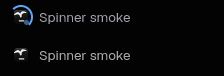

# Tern Tab Spinner

A small [Tern](https://stencil.so/tern) plugin that sends an accent-colored loading highlight around the rounded-square edge of a working tab's existing icon in the **native left sidebar**. The square stays still; only the highlight travels. Idle tabs keep their original icon without an outline.



No replacement sidebar, extra panes, title rewriting, keybindings, polling, processes, or network requests. Tern owns the activity state; the plugin only styles it. The existing gradient and attention indicators are left alone.

## Install

```sh
tern plugin install github.com/jorgoose/tern-tab-spinner
```

Changes load immediately; no Tern restart is needed. Enable side tabs with:

```sh
tern ctl tabs vertical
```

The plugin does not change your tab orientation or other preferences automatically.

To update an installed copy:

```sh
tern plugin install github.com/jorgoose/tern-tab-spinner --force
```

## Behavior

- A working tab gets a rounded-square outline, inset 3 px outside its icon, with a fading highlight that travels around the perimeter once per second. The outline scales with the interface font size.
- The outline stays aligned with the icon; neither the square nor the icon rotates.
- Clearing the working state removes the outline; the icon and tab layout stay intact.
- The highlight uses Tern's `--accent` theme color.
- With system reduced motion enabled, the highlight remains visible in a fixed position.
- Horizontal tabs are intentionally unchanged.

This is an activity indicator, not a percentage or a separate agent-state detector. It follows Tern's `.working` class, including the native progress signals used by agents. A process merely being alive is not enough. Missing activity reporting in a program must be fixed in that program or Tern, not inferred here.

## Compatibility

Verified in the native Linux desktop app on **Tern 0.9.5 (2863c37)**, with dark appearance and side tabs. Other versions and platforms have not been verified.

The plugin uses the documented [`tern.css` API](https://docs.stencil.so/tern/print.html#terncss), but targets **internal UI selectors**:

```css
#sidebar .tn-vt .nav-row.working > .tn-dk::after
```

Those selectors and the icon dimensions can change in a Tern release. If the outline disappears or shifts after an update, disable the plugin and report your Tern version. There is no dependency on the Workspaces Sidebar plugin.

## Disable or uninstall

Disable **Tab Spinner** in Settings → Plugins, or remove an installed copy:

```sh
tern plugin remove tab-spinner
```

For a development link, use `tern plugin unlink tab-spinner` instead. Removal does not change tabs, sessions, or layouts.

## Development

```sh
git clone https://github.com/jorgoose/tern-tab-spinner.git
cd tern-tab-spinner
tern plugin link .
# After an edit:
tern plugin reload
```

`plugin.toml` is the manifest. `window.luau` installs one CSS sheet at load time. A native `perimeter-gradient` animates its phase from 0 to 1 around a fixed rounded rectangle. Two masks exclude the center so the highlight never covers the icon. The generated pseudo-element adds no layout width and does not intercept clicks. There are no Lua timers or per-frame Lua callbacks.

### Verification

Version 0.2.0 was smoke-tested in a live Tern window, not just loaded:

1. The working tab displayed a square-edge highlight.
2. A disposable terminal program emitted native OSC `9;4;3` (indeterminate progress), then `9;4;0` (clear progress). Tern changed the tab from busy to idle and the outline disappeared.
3. Screenshots at animation times 0, 125, 250, 500, and 750 ms showed the highlight traveling along the fixed square's edges and rounded corners.
4. With `tern ctl reduce-motion on`, icon crops at 0 ms and 250 ms were identical, while the stationary highlight remained visible. Reduced motion was restored afterward.
5. The plugin loaded as `ready`, with no plugin problems or CSS parse errors.

Version 0.2.1 replaces fixed outline dimensions with icon-relative edges. Its alignment was checked live with the interface font increased from 13 to 15 px.

No headless test suite is bundled: the critical contract is Tern's actual native rendering. Recheck these behaviors against the target Tern build after changing selectors or CSS. Do not use `tern ctl running` or attention commands on an active user session as a substitute for real progress reporting.

## License

MIT. Independent community plugin; not affiliated with Stencil.
